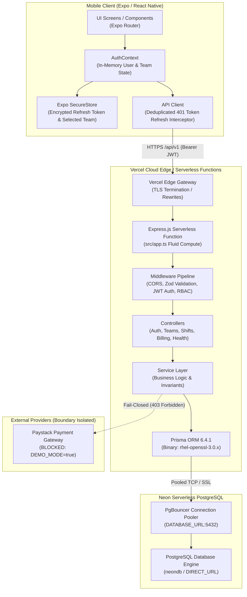
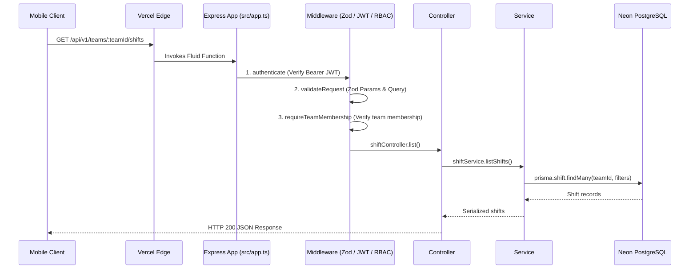
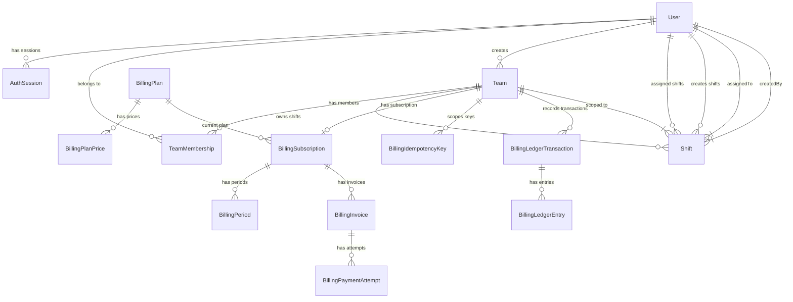

# Rota — System Architecture Specification

## 1. High-Level System Architecture

Rota follows a clean client-server architecture composed of a cross-platform React Native / Expo mobile application, a stateless Node.js / Express backend deployed on Vercel Serverless Functions, and a managed PostgreSQL relational database hosted on Neon.



> [!NOTE]
> **Health Check Endpoint Scope:**<br>
> The health check endpoint `GET /api/v1/health` validates process uptime and Express routing within Vercel's Fluid compute environment. **It does not issue a query to Neon or verify database connectivity.**

---

## 2. Mobile Client Architecture (`/app`)

The mobile client is built on **React Native 0.86.3** and **Expo SDK 57** using **Expo Router v57** for declarative, file-based routing.

### Directory Structure & Route Hierarchy

```text
app/src/app/
├── (auth)/                       # Unauthenticated Route Group
│   ├── _layout.tsx               # Auth layout (Stack navigator)
│   ├── login.tsx                 # Sign-in screen with password visibility toggle
│   └── register.tsx              # Account creation screen with password visibility toggle
├── (app)/                        # Authenticated Route Group
│   ├── _layout.tsx               # App layout (Stack navigator)
│   ├── select-team.tsx           # Multi-tenant team selection and team creation
│   ├── index.tsx                 # Team shift dashboard & operational management
│   └── members.tsx               # Team member roster & role management
├── _layout.tsx                   # Root layout with AuthProvider & SafeAreaProvider
└── index.tsx                     # Entry gatekeeper (routes to select-team or login)
```

### Build & Distribution Status
- **Standalone Android APK (Verified):** Built via EAS Cloud Build ([Build ID `222cb397-2fdb-4286-9b49-009c59a470a8`](https://expo.dev/accounts/bellonaire/projects/rota-mobile/builds/222cb397-2fdb-4286-9b49-009c59a470a8)). Downloaded and user-tested on physical Android hardware for login, dashboard loading, and shift editing.
- **Expo Development Build (`expo-dev-client`):** Outstanding. Compulsory requirement R15.1 mandates a functional development build for local native debugging, which remains to be compiled.

### Authentication & Token Interception Lifecycle

The mobile application utilizes a dual-tier token strategy:
1. **Access Token (In-Memory Only):** Short-lived JWT stored exclusively in JavaScript runtime memory (`apiClient.ts`). Never written to unencrypted async storage or disk, mitigating exfiltration risks.
2. **Refresh Token (Hardware-Backed Encryption):** Long-lived opaque cryptographic token stored in device secure storage via `expo-secure-store` (Android Keystore / iOS Keychain).
3. **In-Flight Refresh Deduplication:** If multiple concurrent API requests trigger HTTP 401 responses, `apiClient.ts` captures them in a promise queue, issues a single refresh request through `authService.refresh()`, updates the in-memory access token, and transparently replays all queued calls without user disruption.

### Custom UI Component Architecture

- **`FormField`:** Fully accessible form field component encapsulating labels, error indicators, and an embedded custom vector `EyeIcon` password visibility toggle. Provides a 48×48 minimum touch target, full screen reader accessibility (`accessibilityRole="button"`, dynamic labels), and guards against keyboard auto-capitalization resets.
- **`ActionButton`:** Theme-consistent interaction button supporting `primary`, `secondary`, and `quiet` variants with built-in loading spinners and disabled state opacity handling.
- **`BrandHeader`:** Unified brand banner with environment badge (`ROTA`), title, and subtitle across auth screens.

---

## 3. Backend Serverless Architecture (`/server`)

The backend is built with **Node.js 22.x**, **Express.js 4.21.2**, and **TypeScript 5.7.3**, deployed on **Vercel Fluid Compute** as a serverless backend.

### Request Processing Pipeline



### Layered Separation of Concerns

1. **Routing Layer (`src/routes/`):** Defines endpoint paths, associates HTTP methods, and attaches validation and authorization middleware.
2. **Validation Layer (`src/schemas/`):** Zod schemas strictly parse and sanitize `params`, `query`, and `body` inputs prior to controller execution, returning HTTP 400 with structured validation errors.
3. **Authorization Layer (`src/middleware/`):**
   - `authenticate.ts`: Extracts and verifies access JWT, binding `req.auth = { userId }`.
   - `teamAuthorization.ts`: Resolves `req.teamMembership`. If the user is not a member of the target team, it throws **HTTP 404 (Team not found)** to prevent tenant enumeration. If the user is a member but lacks required permissions, it throws **HTTP 403 (Insufficient team permissions)**.
   - **Centralized Role Permission Boundaries:**
     - `OWNER`: Granted all permissions including `MANAGE_TEAM`. Only the `OWNER` can add members, change member roles, remove members, view team billing, and initiate checkout.
     - `MANAGER`: Granted `MANAGE_OPERATIONAL_WORK` and `MANAGE_STAFF`, but **NOT** `MANAGE_TEAM`. Managers can schedule, update, and cancel shifts, but cannot manage roster membership or billing.
     - `STAFF`: Granted `VIEW_OPERATIONAL_WORK` (viewing shifts and rosters).
     - Roster viewing and shift querying require active team membership (`requireTeamMembership`).
     - `GET /api/v1/teams/:id` requires authentication and performs a membership-scoped lookup in `teamService.getForUser()`.
     - `DEMO_MODE=true` blocks billing checkout with HTTP 403 regardless of user role.
4. **Controller Layer (`src/controllers/`):** Maps HTTP request objects to domain parameters and formats status codes.
5. **Service Layer (`src/services/`):** Encapsulates core business rules, transactional guarantees, invariant enforcement, and external provider abstractions.
6. **Persistence Layer (`src/database/prisma.ts`):** Singleton Prisma Client configured with query logging and connection pooling.

---

## 4. Entity-Relationship Data Model

The database schema is defined in [server/prisma/schema.prisma](./server/prisma/schema.prisma) across 15 models.



### Shift Lifecycle & Cancellation Metadata
In `model Shift`:
- `status`: Transitions between `SCHEDULED` and `CANCELLED`.
- `cancelledAt`: Timestamp recorded upon cancellation.
- `cancelledByUserId`: Foreign key recording the cancelling actor.
- `updatedAt`: Verified via optimistic concurrency check (`assertFresh`) to prevent race-condition state overwrites.
- *Schema Note:* Shift cancellation captures actor and timestamp; **no cancellation reason field exists** in the database schema or API specification.

### Data Integrity Rules & Cascade Constraints

| Relationship | Constraint | Purpose |
| :--- | :--- | :--- |
| `Team.createdByUserId` $\to$ `User.id` | `onDelete: Restrict` | Preserves audit trail; team creator record cannot be deleted while team exists. |
| `TeamMembership.teamId` $\to$ `Team.id` | `onDelete: Cascade` | Deleting a team automatically removes its member records. |
| `TeamMembership.userId` $\to$ `User.id` | `onDelete: Cascade` | Deleting a user automatically purges their team memberships. |
| `TeamMembership` Unique `[teamId, userId]` | `@@unique` | Enforces that a user can hold at most one membership role per team. |
| `Shift.teamId` $\to$ `Team.id` | `onDelete: Cascade` | Shifts belong strictly to their parent team. |
| `Shift.assignedToUserId` $\to$ `User.id`| `onDelete: Restrict` | Prevents deleting staff members who have assigned shift records. |
| `AuthSession.userId` $\to$ `User.id` | `onDelete: Cascade` | Deleting a user revokes all active refresh token sessions. |

---

## 5. Deployment & Runtime Infrastructure

### Vercel Serverless Function Deployment
- **Root Directory:** `server`
- **Framework Preset:** `express` (Explicitly pinned via `server/vercel.json`)
- **Entrypoint:** `server/src/app.ts` (Detected automatically by Vercel Express preset; exports Express app as default export without port binding)
- **Node.js Engine:** `22.x` (Pinned via `package.json#engines.node`)
- **Prisma Engines:** Compiles `libquery_engine-rhel-openssl-3.0.x.so.node` during build to match Vercel's Amazon Linux 2023 environment.
- **Build Lifecycle:** `"postinstall": "prisma generate"` guarantees query engines exist prior to compilation.

### Neon Serverless PostgreSQL Database
- **Region:** AWS `eu-west-2` (London)
- **Pooling:** PgBouncer connection pooling via `DATABASE_URL` (port 5432) to prevent connection exhaustion during serverless cold starts.
- **Direct Connection:** `DIRECT_URL` for migration scripts and schema synchronizations.

### Expo Application Services (EAS Build)
- **Build ID:** `222cb397-2fdb-4286-9b49-009c59a470a8`
- **Project ID:** `66658de4-4c3b-4467-b8b6-eb799dac09ad` (Owner: `bellonaire`)
- **Target Profile:** `preview` (Compiles standalone Android `.apk` package)
- **Target Backend:** Pinned to `https://rota-api-demo.vercel.app/api/v1` via `EXPO_PUBLIC_API_URL`

---

## 6. Subsystem Status & Deliberate Deferred Boundaries

To ensure complete technical transparency, the following subsystems are explicitly documented as deferred or incomplete:

1. **Live Payment & Billing Processing (`DISABLED / DEMO MODE`):**
   - Enforced by `DEMO_MODE=true` in `server/src/config/env.ts`.
   - Checkout endpoint (`POST /api/v1/teams/:teamId/billing/checkout`) and Webhook ingestion (`POST /api/v1/billing/webhooks/paystack`) immediately return `403 Forbidden`.
   - While unit-tested models exist for proration, calendar math, and ledger entries, live external transactions are strictly disabled, and payment reconciliation is not certified end-to-end.
2. **Asynchronous Background Workers (`PARTIAL / INACTIVE`):**
   - A PostgreSQL-backed lease queue exists in code (`server/src/jobs/webhook-event-queue.ts`), but the worker process (`webhook-worker.ts`) is not running in Vercel's serverless environment.
   - General background queues (e.g. BullMQ on Redis) are unbuilt.
3. **Redis Caching & Replica Routing (`NOT IMPLEMENTED`):**
   - Compulsory requirements R11.2 (read/write replica routing) and R11.3 (Redis caching of team rosters and shift calendars with invalidation) are currently unbuilt. Queries execute against single primary database.
4. **Push Notifications & Delay Queue (`NOT IMPLEMENTED`):**
   - Shift reminders and roster notifications are not connected to any push notification gateway (FCM / APNs / Expo Push). Quiet-hours delay queue is unbuilt.
5. **Physical Database Sharding (`PROPOSED DESIGN ONLY`):**
   - The system operates on a single PostgreSQL instance. The compulsory two-database sharding simulation script (`R12.2`) is pending.
6. **Load Testing (`NO EVIDENCE CREATED`):**
   - k6 load scripts have not been executed (`load-tests/README.md`).
7. **Test Coverage Reality:**
   - 52 passing unit tests validate offline domain invariants (proration, calendar math, demo mode, RBAC matrix). All 10 database integration test suites were skipped during non-destructive testing; the reported 52-test unit run did not execute them, and makes no claim that they passed or failed.
