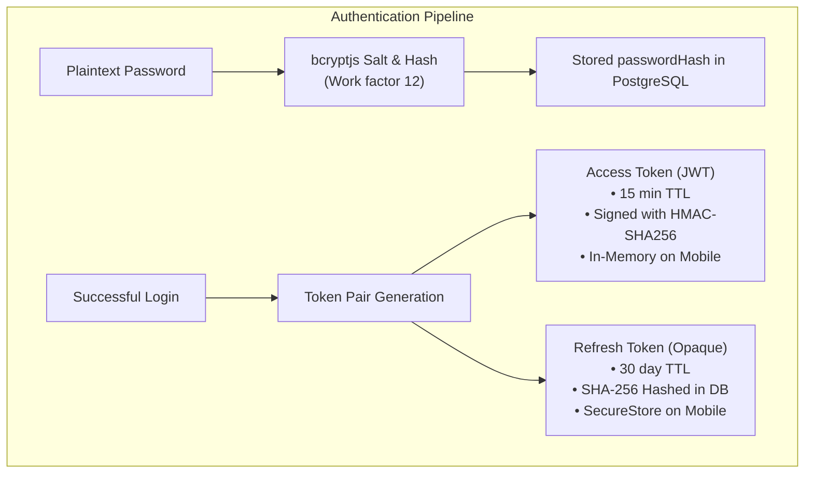
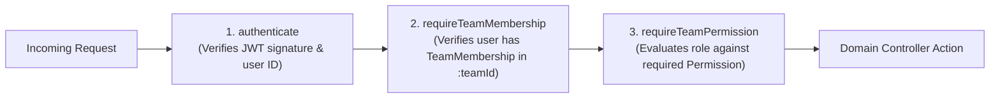

# Rota — Security & Compliance Architecture

## 1. Threat Model & Security Posture (10 Core Attack Vectors)

Rota handles sensitive organizational scheduling, staff personal identifiers, and financial billing records. The security model addresses 10 distinct attack vectors, explicitly distinguishing implemented defense controls from missing or incomplete protections:

| # | Threat Vector | Risk Description | Defense Status | Mitigation Mechanism / Status |
| :-: | :--- | :--- | :---: | :--- |
| **1** | **Token Theft & Replay Attacks** | Interception of bearer tokens to impersonate users across devices. | **IMPLEMENTED** | Short-lived access JWTs (15 min), SHA-256 hashed refresh tokens, and strict token-family revocation on reuse detection. |
| **2** | **Tenant Cross-Talk / IDOR** | Insecure direct object reference attempting to access another team's shifts or rosters. | **IMPLEMENTED** | Middleware validates `TeamMembership` on every team route, scoping Prisma queries strictly by `teamId`. |
| **3** | **Tenant Enumeration & Discovery** | Attackers probing random team UUIDs to identify existing businesses. | **IMPLEMENTED** | `teamAuthorization.ts` returns **HTTP 404 (Team not found)** for non-members rather than 403, preventing brute-force enumeration. |
| **4** | **Privilege Escalation** | Staff member attempting to schedule shifts, modify roles, or access billing. | **IMPLEMENTED** | Centralized immutable RBAC permission matrix evaluated via `requireTeamPermission`, returning HTTP 403 for unauthorized roles. |
| **5** | **Financial Leakage & Live Billing Exploits** | Accidental charges, sandbox leakage, or unverified provider callbacks. | **IMPLEMENTED (FAIL-CLOSED)** | Strict `DEMO_MODE=true` boundary blocking checkout and webhook ingestion with HTTP 403. Payment reconciliation uncertified. |
| **6** | **Credential & Signature Tampering** | Password interception or forging external payment webhook payloads. | **IMPLEMENTED** | bcryptjs password hashing with salt, HMAC-SHA512 webhook signature verification over raw request buffers, and SecureStore on mobile. |
| **7** | **Concurrent State Overwrite & Race Conditions** | Simultaneous edits causing conflicting shift assignments or ghost shifts. | **IMPLEMENTED** | Serialized database transactions with optimistic concurrency checks on `updatedAt` (`assertFresh`), returning HTTP 409 on conflict. |
| **8** | **API Abuse & Brute-Force Denial of Service** | High-frequency automated attacks on login, registration, or reset endpoints. | **MISSING / INCOMPLETE** | Distributed Redis sliding-window rate limiting is **not implemented**; routes are currently unthrottled in serverless Vercel. |
| **9** | **Mobile Secret Extraction & Reverse-Engineering** | Decompiling APK to harvest private API keys, keystores, or backend secrets. | **PARTIALLY IMPLEMENTED** | `.gitignore` excludes local secrets and only `EXPO_PUBLIC_API_URL` is configured in public build config; however, automated deep git history scans (e.g. gitleaks) and decompiled APK dex audits have not been performed. Certificate pinning is missing. |
| **10** | **Webhook Replay & Financial Ledger Tampering** | Replaying payment webhook payloads to fabricate staff seat entitlements. | **PARTIALLY IMPLEMENTED** | `BillingIdempotencyKey` and double-entry ledger models exist in schema, but live webhook ingestion is blocked by demo mode and DB-level immutability triggers are unexecuted in integration tests. |

---

## 2. Authentication Security Architecture



### Key Authentication Invariants

1. **Dual-Token Architecture:**
   - **Access JWT:** Valid for 15 minutes (`ACCESS_TOKEN_TTL_MINUTES=15`). Injected in `Authorization: Bearer <token>` header. Held in ephemeral memory only.
   - **Secret Requirement:** `JWT_ACCESS_SECRET` is strictly validated by Zod at server boot to enforce a **minimum length of 32 characters**; the application fails to start if an insecure secret is supplied.
2. **Opaque Refresh Tokens with Family Rotation:**
   - Refresh tokens are 64-character cryptographically random strings generated via Node.js `crypto.randomBytes`.
   - **Database Storage:** The raw refresh token is returned once to the client and never saved to the database. PostgreSQL stores only its one-way SHA-256 hash (`tokenHash`).
   - **Token Family Invalidation:** Each session chain is assigned a `familyId`. When a refresh token is presented, the server checks if it has already been consumed (`usedAt != null`). If reuse is detected, **all sessions in that family are immediately revoked**, neutralizing stolen refresh tokens.
3. **Password Storage & Form Security:**
   - User passwords are required to be at least 8 characters long and hashed using `bcryptjs` with 12 salt rounds (`PASSWORD_HASH_ROUNDS = 12`) before persistence.
   - On the mobile client, password inputs default to hidden (`secureTextEntry=true`), and auto-capitalization and auto-correction are explicitly disabled to prevent dictionary leakage.
   - Credentials on mobile are stored in `expo-secure-store`, backed by Android Keystore and iOS Keychain.

---

## 3. Authorization & Tenant Isolation (RBAC)

Rota enforces multi-tenant boundaries at the software architecture level. Every organization is represented as a `Team`.

### Centralized Permission Matrix

Defined in [server/src/rbac/permissions.ts](./server/src/rbac/permissions.ts):

| Permission | Description | OWNER | MANAGER | STAFF |
| :--- | :--- | :---: | :---: | :---: |
| `VIEW_OPERATIONAL_WORK` | View team schedules, shifts, and member rosters | **YES** | **YES** | **YES** |
| `MANAGE_OPERATIONAL_WORK`| Create, update, assign, and cancel team shifts | **YES** | **YES** | NO |
| `MANAGE_STAFF` | Assign and coordinate staff members on shifts | **YES** | **YES** | NO |
| `MANAGE_MANAGERS` | Promote or demote manager roles | **YES** | NO | NO |
| `MANAGE_TEAM` | Add/remove members, update roles, view billing, checkout | **YES** | NO | NO |

### Key Access-Control Rules & Invariants

- **`MANAGE_TEAM` is strictly OWNER only:** Adding members (`POST /api/v1/teams/:teamId/members`), updating member roles (`PATCH /api/v1/teams/:teamId/members/:userId/role`), removing members (`DELETE /api/v1/teams/:teamId/members/:userId`), viewing team billing (`GET /api/v1/teams/:teamId/billing`), and initiating checkout require `MANAGE_TEAM`. Managers do NOT possess `MANAGE_TEAM` and are rejected with HTTP 403 Forbidden.
- **`MANAGE_OPERATIONAL_WORK` (OWNER or MANAGER):** Creating, updating, assigning, and cancelling shifts require `MANAGE_OPERATIONAL_WORK`, which is held by both Owners and Managers.
- **Team Membership (`requireTeamMembership`):** Listing shifts (`GET /api/v1/teams/:teamId/shifts`) and viewing roster members (`GET /api/v1/teams/:teamId/members`) require active team membership. Non-members receive **HTTP 404 (Team not found)** to prevent tenant enumeration.
- **Team Lookup (`GET /api/v1/teams/:id`):** Requires authentication and performs a membership-scoped lookup in `teamService.getForUser()`. Non-members receive HTTP 404.
- **Fail-Closed Billing Boundary:** `DEMO_MODE=true` blocks checkout and webhook ingestion with HTTP 403 Forbidden regardless of the user's role.

### Middleware Defense-in-Depth

Every request to a team-scoped resource passes through three independent validation filters:



1. **`authenticate`:** Validates bearer JWT signature, expiration, and payload format.
2. **`requireTeamMembership`:** Queries `TeamMembership` using `teamId` and `req.auth.userId`. If no membership exists, it throws **HTTP 404 (Team not found)** to prevent tenant enumeration.
3. **`requireTeamPermission`:** Evaluates the resolved `membership.role` against the permission matrix. Rejects unauthorized roles with **HTTP 403 (Insufficient team permissions)**.

---

## 4. Financial & Payment Safety Boundaries

Because payment gateway integrations involve financial liability, Rota enforces a **fail-closed financial architecture**.

### Demo Mode Fail-Closed Invariant (`DEMO_MODE=true`)
- In [server/src/config/env.ts](./server/src/config/env.ts), `DEMO_MODE` defaults in code to `false` (`.default('false')`), but is explicitly configured to `true` in the live Vercel demonstration environment.
- **Fail-Closed Boundary & Mandatory State:** Demo mode must remain explicitly enabled in the production demonstration environment until end-to-end payment reconciliation and webhook processing have been independently tested and certified.
- **Checkout Blocking:**
  ```typescript
  // billing.controller.ts
  if (env.DEMO_MODE) {
    res.status(403).json({
      error: 'Forbidden',
      message: 'Billing checkout is disabled in the demonstration environment.',
    });
    return;
  }
  ```
- **Webhook Ingestion Blocking:**
  ```typescript
  // billing.controller.ts
  if (env.DEMO_MODE) {
    res.status(403).json({
      error: 'Forbidden',
      message: 'Paystack webhook ingestion is disabled in the demonstration environment.',
    });
    return;
  }
  ```
- Automated unit test suite (`server/src/billing/demo-mode.test.ts`) actively verifies that checkout and webhook calls return HTTP 403 when `DEMO_MODE=true`.

### Webhook Signature Verification Architecture
When running in production with live gateways:
- Webhooks arrive at `/api/v1/billing/webhooks/paystack`.
- Express captures the unparsed raw buffer payload via `express.raw({ limit: '100kb', type: 'application/json' })`.
- The `x-paystack-signature` header is compared against an HMAC-SHA512 digest computed over `req.rawBody` using `PAYSTACK_TEST_SECRET_KEY`.
- Timing-safe comparisons prevent timing attacks.

### Double-Entry Ledger Principles
The database schema defines balanced double-entry transaction models in `BillingLedgerTransaction` and `BillingLedgerEntry`:
- The schema and pricing domain models structure transactions such that $\sum \text{debitCents} = \sum \text{creditCents}$.
- Idempotency models in `BillingIdempotencyKey` are designed to store transaction hashes to suppress duplicate charges from network retransmits.
- *Audit Status:* While Prisma models and offline calculation tests exist, database-level immutability triggers (preventing UPDATE/DELETE) and live high-concurrency race condition tests have not been executed or proven end-to-end.

---

## 5. Input Sanitization & Data Protection

1. **Strict Zod Parsing:** All API parameters (`params`), query strings (`query`), and JSON bodies (`body`) are validated against Zod schemas before reaching business logic. Unknown fields are stripped, and invalid types trigger structured HTTP 400 responses.
2. **SQL Injection Defense:** All database communication is conducted via Prisma ORM using parameterized queries. No raw SQL concatenation is utilized.
3. **Error Masking:** In production mode (`NODE_ENV=production`), server error handlers sanitize stack traces and internal database errors, returning standard `{ error: 'Internal Server Error', message: '...' }` envelopes to prevent reconnaissance.

---

## 6. Operational Security & Secrets Management

- **Git Secret Exclusion:** `server/.env`, `app/.env`, `app/credentials.json`, and `app/keystores/` are explicitly excluded by `.gitignore`. No private keys, database passwords, or keystore credentials reside in active tracked files. Automated deep Git history scanners (e.g. TruffleHog/Gitleaks) and dex decompilation scans on compiled APK artifacts have not yet been executed.
- **Git Stash Protection:** Experimental renewal settlement code (`stash@{0}: WIP 5E.3B unsafe renewal handler - needs trusted provider linkage`) is isolated in a Git stash to ensure unverified financial handlers are never deployed to production.
- **Vercel Environment Encryption:** Sensitive environment variables (`DATABASE_URL`, `JWT_ACCESS_SECRET`) are encrypted at rest by Vercel's secret management platform.
- **Client Bundle Safety:** Verified via codebase audit that `EXPO_PUBLIC_API_URL` is the sole `EXPO_PUBLIC_` variable configured in public mobile configuration; private keys and server environment secrets are excluded from mobile bundles.
