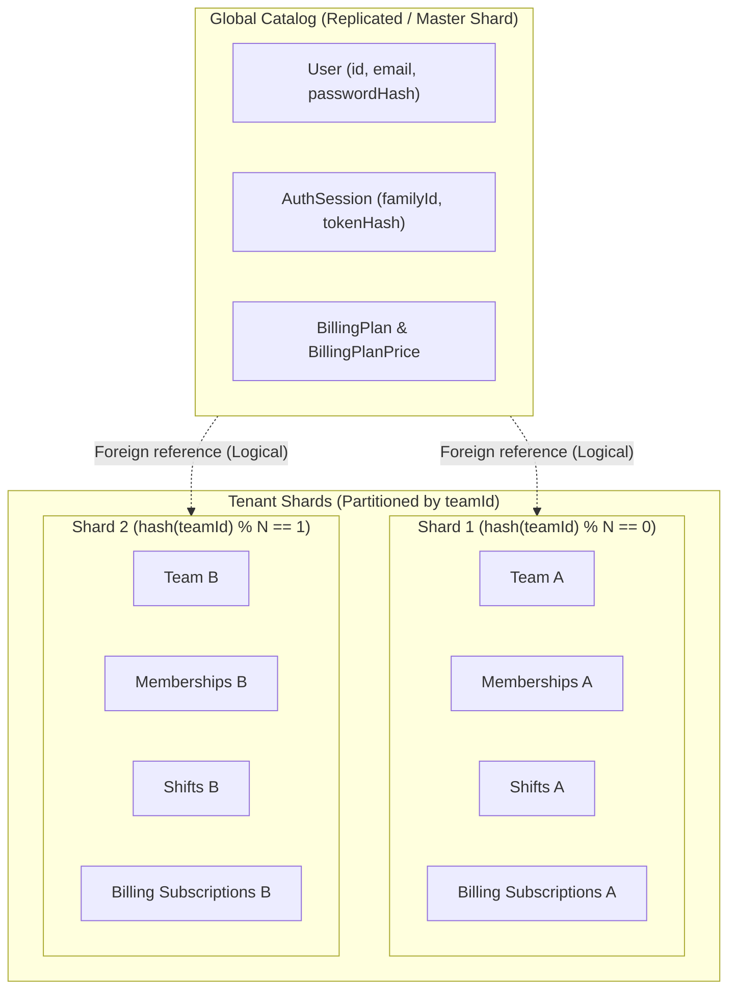

# Rota — Horizontal Partitioning & Sharding Strategy

> [!IMPORTANT]
> **Implementation Reality Statement & Compulsory Requirement Status:**<br>
> Rota currently operates on a **single logical PostgreSQL instance** hosted on Neon Serverless Postgres.<br>
> **Physical database sharding, Citus clustering, and table partitioning are NOT currently active in production.**<br>
> The compulsory graduation requirement for a functional two-database PostgreSQL sharding simulation demonstrating routing by `teamId` (Requirement **R12.2**) remains **PENDING** implementation. No two-database simulation scripts or multi-database Prisma client routing configurations have yet been executed in this repository.<br>
> This document serves as the formal **technical architecture and partition design specification** for scaling Rota horizontally as tenant volume grows.

---

## 1. Architectural Motivation for Sharding

Rota is a multi-tenant application where the primary operational unit is a **Team**. Shift operations, staff scheduling, rosters, and operational audits are inherently isolated to the team context.

As the system scales to tens of thousands of businesses:
1. **Query Concurrency:** Daily roster views and shift check-ins will concentrate high write and read traffic on operational tables.
2. **Index Bloat:** High-volume tables (especially `Shift`, `BillingLedgerEntry`, and `BillingWebhookEvent`) will exceed RAM cache working sets on a single monolithic database node.
3. **Tenant Blast Radius:** Sharding guarantees that a spike in activity from one large business does not degrade query performance for other tenants.

---

## 2. Partition Key Evaluation & Selection

The selection of the partition key determines data co-location and query routing efficiency.

| Candidate Key | Pros | Cons | Decision |
| :--- | :--- | :--- | :---: |
| `userId` | User queries hit a single node. | Breaks team rosters; shift queries require cross-node joins across all team members. | **REJECTED** |
| `shiftDate` (Range) | Natural for historical archiving. | Severe write hotspotting (all active writes hit today's partition); cross-tenant data co-mingled. | **REJECTED** |
| `teamId` (Tenant) | The vast majority of operational workflows (shifts, member lookups, schedules) naturally scope to a single team. Co-locates team shifts, members, subscriptions, and ledger records on the same partition. | Cross-team user profiles and global authentication require dedicated routing. | **SELECTED** |

### Selected Strategy: Tenant-Based Partitioning (`teamId`)

By using `teamId` as the primary partition key:
- All queries of the form `SELECT * FROM Shift WHERE teamId = :teamId AND startsAt >= :start` route directly to a single shard.
- Intra-team operations (e.g., adding a shift, updating a member's role, checking roster conflicts) execute as local, single-node ACID transactions.

---

## 3. Entity Classification (Global vs. Sharded)



### 1. Global Entities (Stored on Master / Router Node)
- **`User` & `AuthSession`:** Identity is global. A single user can belong to multiple teams (e.g., a manager at Clinic A and a part-time nurse at Clinic B). The initial authentication request (`POST /api/v1/auth/login`) resolves user credentials before any team is selected.
- **`BillingPlan` & `BillingPlanPrice`:** Global reference catalog of subscription tiers (Starter, Team, Business). Low-write, high-read. Cached in-memory across services.

### 2. Sharded Entities (Distributed by `teamId`)
- **`Team`**
- **`TeamMembership`**
- **`Shift`**
- **`BillingSubscription`**
- **`BillingPeriod`**
- **`BillingInvoice`**
- **`BillingPaymentAttempt`**
- **`BillingLedgerTransaction`**
- **`BillingLedgerEntry`**
- **`BillingIdempotencyKey`**

---

## 4. Cross-Shard Challenges & Architectural Solutions

### Challenge 1: A User Belongs to Multiple Teams
- **Problem:** When a user logs in and calls `GET /api/v1/teams`, the application must return all teams they belong to. If teams are scattered across different shards, this query becomes a scatter-gather operation.
- **Solution:** Maintain a lightweight global lookup table `UserTeamDirectory(userId, teamId, shardId)` on the primary database, or replicate `TeamMembership` pointers to the user record. The mobile app queries this index once during team selection, and then binds all subsequent API calls to the target `teamId`.

### Challenge 2: Sharded Foreign Keys
- **Problem:** Cross-shard foreign keys cannot be enforced by standard database constraints (e.g., `Shift.assignedToUserId` referencing `User.id` on a separate global database).
- **Solution:** Enforce application-level foreign key validation in the service layer using transactional pre-checks prior to inserting or updating shifts.

### Challenge 3: Distributed Transactions & Cross-Shard Workflows
- **Problem:** Multi-shard transactions introduce network latency and two-phase commit (2PC) failure modes.
- **Solution (Theoretical Architecture):** Rota's core domain confines the vast majority of operational mutations (shifts, local rosters, and team settings) to a single team. By co-locating team-scoped entities on the same shard, intra-tenant operations execute without cross-shard joins. However, cross-team operations, global user account synchronization, and centralized billing reconciliation present distributed routing challenges that require asynchronous saga patterns and two-phase commit isolation rather than simple monolithic ACID guarantees.
- *Status:* This remains an architectural design proposal; physical sharding and distributed transaction isolation have not yet been implemented or benchmarked in code.

---

## 5. Implementation & Migration Roadmap

### Phase 1: Current Baseline (Implemented)
- Single Neon PostgreSQL instance.
- Composite indexing optimized for tenant filtering:
  - `Shift: @@index([teamId, startsAt])`
  - `Shift: @@index([teamId, status, startsAt])`
  - `TeamMembership: @@unique([teamId, userId])`
  - `BillingLedgerTransaction: @@index([teamId, occurredAt])`
- Connection pooling managed via PgBouncer.

### Phase 2: PostgreSQL Declarative Partitioning (Planned)
- Implement native PostgreSQL table partitioning on high-growth tables:
  ```sql
  CREATE TABLE shifts (
      id UUID NOT NULL,
      team_id UUID NOT NULL,
      starts_at TIMESTAMPTZ NOT NULL,
      ...
      PRIMARY KEY (id, team_id)
  ) PARTITION BY HASH (team_id);

  CREATE TABLE shifts_p0 PARTITION OF shifts FOR VALUES WITH (MODULUS 4, REMAINDER 0);
  CREATE TABLE shifts_p1 PARTITION OF shifts FOR VALUES WITH (MODULUS 4, REMAINDER 1);
  CREATE TABLE shifts_p2 PARTITION OF shifts FOR VALUES WITH (MODULUS 4, REMAINDER 2);
  CREATE TABLE shifts_p3 PARTITION OF shifts FOR VALUES WITH (MODULUS 4, REMAINDER 3);
  ```
- Keeps single-node simplicity while improving index locality and buffer pool cache hit ratios.

### Phase 3: Distributed Multi-Node Cluster (Future Scale)
- Deploy Citus extension or Vitess/CockroachDB.
- Distribute partitioned tables across physical database nodes with automatic tenant rebalancing and read replicas.
