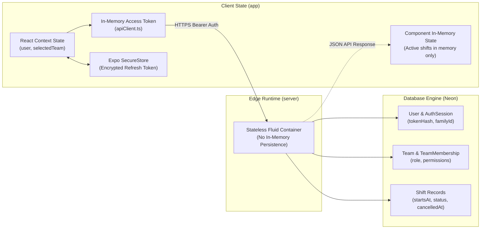
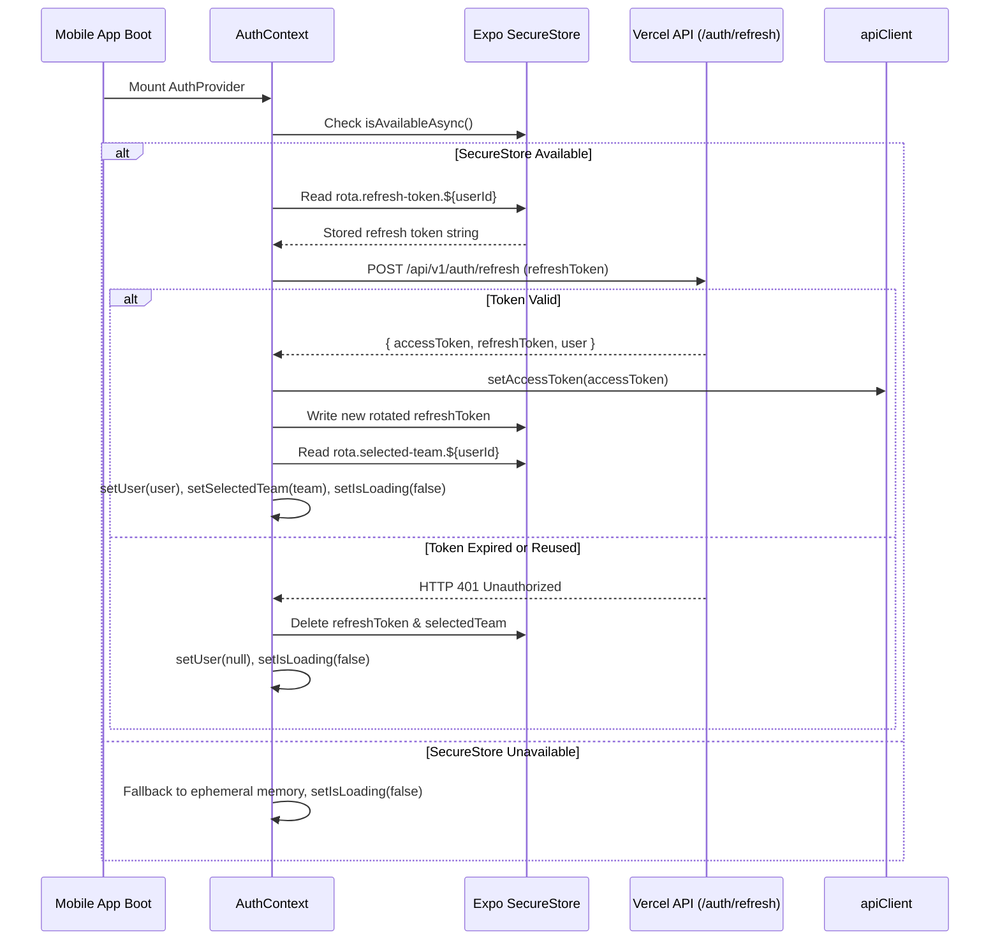

# Rota — State Management Specification

## 1. Overview of State Lifecycle

Rota coordinates state across two distinct architectural boundaries:
1. **Client-Side State (Mobile Client):** Manages user session state, secure credential persistence, active tenant selection, and local view state across Expo Router screens using React Context and standard state hooks.
2. **Server-Side State (Serverless Backend & PostgreSQL):** Purely stateless execution in Vercel Fluid compute containers, with Neon PostgreSQL serving as the single source of truth for identities, team memberships, shift schedules, and session tokens.



---

## 2. Client-Side State Management

Client state is encapsulated inside [app/src/context/AuthContext.tsx](./app/src/context/AuthContext.tsx) and component-level hooks.

> [!IMPORTANT]
> **State Engine Reality:**<br>
> The mobile application manages client state exclusively via **React Context and standard React hooks (`useState`, `useRef`, `useCallback`)**.<br>
> **TanStack Query (`@tanstack/react-query`) is NOT installed or implemented.**<br>
> Furthermore, **shifts are held purely in component runtime memory**. There is no offline database or persistent storage layer (e.g. AsyncStorage or SQLite) for shift records. When the application closes or refreshes, shifts must be refetched from the backend API.

### A. State Breakdown

| State Variable | Storage Location | Lifetime | Security / Purpose |
| :--- | :--- | :--- | :--- |
| `user` (`User \| null`) | In-Memory (React State) | App session | Authenticated user profile (`id`, `email`, `name`). Cleared on sign-out. |
| `selectedTeam` (`Team \| null`) | In-Memory + SecureStore | Persistent | Active operational context. Stored under `rota.selected-team.${userId}`. |
| `accessToken` (`string \| null`) | In-Memory (`apiClient.ts`) | 15 minutes | Injected into `Authorization: Bearer <token>` headers. Never written to disk. |
| `refreshToken` (`string \| null`) | Hardware SecureStore | 30 days | Opaque crypto token stored under `rota.refresh-token.${userId}`. |
| `shifts` (`Shift[]`) | In-Memory Component State | Active screen | Loaded from `GET /api/v1/teams/:teamId/shifts`. Not persisted offline. |
| `isLoading` (`boolean`) | In-Memory (React State) | Boot phase | Blocks navigation rendering until SecureStore session restoration completes. |
| `isPersistenceAvailable` | In-Memory (React State) | App session | Flags whether device keystore/keychain is accessible. |

---

### B. Session Restoration Sequence

On application cold start, `AuthProvider` initializes session restoration:



---

### C. Concurrent Token Refresh Deduplication

To prevent race conditions where multiple parallel network requests attempt to refresh the same token simultaneously, `apiClient.ts` and `AuthContext.tsx` maintain an in-flight refresh mutex lock:

```typescript
// AuthContext.tsx token refresh deduplication lock (illustrative pseudocode)
const refreshInFlightRef = useRef<Promise<string | null> | null>(null);

const refreshSession = useCallback(async (): Promise<string | null> => {
  if (!refreshTokenRef.current) return null;

  // Return the active in-flight promise if a refresh is already underway
  if (refreshInFlightRef.current) return refreshInFlightRef.current;

  refreshInFlightRef.current = authService
    .refresh(refreshTokenRef.current)
    .then(async (tokens) => {
      apiClient.setAccessToken(tokens.accessToken);
      if (userRef.current?.id) {
        await persistRefreshToken(userRef.current.id, tokens.refreshToken);
      }
      return tokens.accessToken;
    })
    .finally(() => {
      refreshInFlightRef.current = null; // Release lock
    });

  return refreshInFlightRef.current;
}, [persistRefreshToken]);
```

---

## 3. Server-Side State Management

Because the backend executes on **Vercel Serverless Functions**, individual compute instances are ephemeral and may be destroyed or spawned at any time.

### Statelessness Invariant
- **No Shared Memory:** Express memory is not shared between requests or across concurrent instances.
- **No Local File System Reliance:** Uploads, temp files, and logs are not persisted to container disks.
- **Single Source of Truth:** All persistent state resides in the managed PostgreSQL database on Neon.

---

### Database-Backed State Models

#### 1. Authentication Sessions (`AuthSession`)
Server-side refresh token state is governed by token families to prevent replay attacks:

```prisma
model AuthSession {
  id        String    @id @default(uuid())
  userId    String
  tokenHash String    @unique      // SHA-256 hash of opaque token
  familyId  String                 // Groups tokens issued from same lineage
  expiresAt DateTime               // Default: 30 days
  usedAt    DateTime?              // Populated when token is exchanged
  revokedAt DateTime?              // Populated on logout or reuse detection
  createdAt DateTime  @default(now())
}
```

- **Clean Exchange:** When a refresh token is presented, its `usedAt` timestamp is populated, and a new replacement `AuthSession` is inserted under the same `familyId` in a single atomic transaction.
- **Reuse Detection:** If an incoming request presents a token whose `usedAt` is already set, the server detects a replay attack and immediately revokes **all** sessions sharing that `familyId` (`revokedAt = now()`), forcing re-authentication.

#### 2. Idempotency State (`BillingIdempotencyKey`)
Protects financial transactions from duplicate processing during network retries:

```prisma
model BillingIdempotencyKey {
  id             String                  @id @default(uuid())
  scope          String                  @db.VarChar(128)
  key            String                  @db.VarChar(255)
  requestHash    String                  @db.VarChar(128)
  status         BillingIdempotencyStatus @default(IN_PROGRESS)
  responseStatus Int?
  responseBody   Json?
  expiresAt      DateTime
  completedAt    DateTime?
}
```

- Keys transition through `IN_PROGRESS` $\to$ `SUCCEEDED` / `FAILED`.
- Concurrent duplicate requests with the same key are held or rejected.

---

## 4. State Invalidation & Cascade Workflows

| Event | Client-Side Invalidation | Server-Side State Invalidation |
| :--- | :--- | :--- |
| **User Sign Out** | • In-memory `accessToken` cleared<br>• `user` and `selectedTeam` reset to `null`<br>• SecureStore refresh token deleted | Target `AuthSession` marked with `revokedAt = now()`. |
| **Sign Out All Devices** | Same as Sign Out | All `AuthSession` records matching `userId` marked with `revokedAt = now()`. |
| **Shift Update / Cancel** | Dashboard shift list refetched via `shiftService.listShifts()` | Shift `status` set to `CANCELLED`, `cancelledAt` and `cancelledByUserId` updated. *(No cancellation reason stored)*. |
| **Team Member Role Change**| Member list refetched; UI updates role badge | `TeamMembership.role` updated; subsequent requests evaluate new permission set. |
| **Team Deletion** | Navigates user back to `select-team` | PostgreSQL `CASCADE` deletes memberships, shifts, and team subscriptions. |

---

## 5. Unimplemented / Deferred State Systems

1. **Client-Side Query Cache (TanStack Query):** Not installed. Query key factories, `staleTime`, `gcTime`, and cache invalidation hooks are unbuilt.
2. **Offline Shift Persistence:** Shifts are held exclusively in runtime memory. No local SQLite database or encrypted offline shift cache is implemented.
3. **Optimistic UI Updates with Rollback:** Shift mutations wait for server HTTP responses before updating local screen state. Automatic mutation rollback on network failure is unbuilt.
4. **Distributed Cache (Redis):** No Redis cluster is active. Shift queries and team membership lookups hit PostgreSQL on every request.
5. **Background Queue State (BullMQ):** Background job state (e.g., job retries, dead letter queues) is not implemented.
