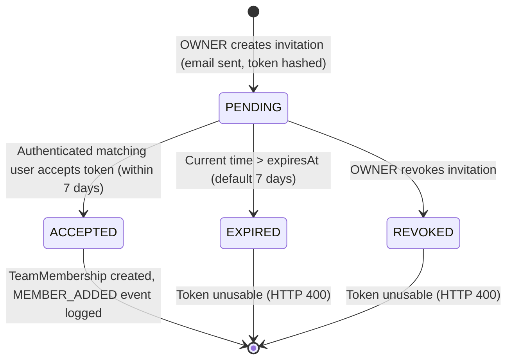

# ROTA — Secure Team Invitations Backend Evidence (R03.3)

> **Dev and Design HQ — Product Design and Engineering Bootcamp**  
> **Requirement ID:** R03.3 — Secure, email-based team invitations and invite token lifecycle  
> **Repository:** `C:\Users\USER\rota-mobile`  
> **Baseline Commit:** `3b01328068cf50a445173be22e486ffe210a91db` on branch `main`  
> **Target Status:** **PARTIAL** (Backend API, database schema, partial index, token cryptographic security, email service, transactional serializable acceptance, and 20 integration test scenarios verified against disposable Neon database; mobile deep-link acceptance UI [R03.4] and production deployment remaining)  
> **Execution Date:** November 4, 2026  

---

## 1. Test Environment & Database Safety Verification

All migrations and integration test suites were executed exclusively against the authorized isolated disposable Neon PostgreSQL instance under strict fail-closed safety guard enforcement.

| Attribute | Verified Value | Safety Invariant Proof |
| :--- | :--- | :--- |
| **Neon Project ID** | `calm-bird-93784411` | Approved disposable test project (`rota-auth-disposable`) |
| **Database Name** | `neondb` | Approved disposable database |
| **Host Endpoint** | `ep-small-dawn-za43lp0z.c-2.eu-west-2.aws.neon.tech` | Verified disposable AWS eu-west-2 endpoint |
| **Database Mode** | `AUTH_TEST_DATABASE=disposable` | Validated by `authIntegrationSkipReason()` |
| **Protected Environments** | Untouched | Demo (`ep-falling-pine`) and persistent (`ep-proud-shadow`) databases strictly refused |
| **Protected Stash** | `stash@{0}` untouched | `WIP 5E.3B unsafe renewal handler - needs trusted provider linkage` preserved |
| **Prisma Migration** | `20261104150000_add_team_invitations` | Applied cleanly via Prisma Migrate Deploy; zero drift |
| **Credential Sanitization** | Redacted | Zero passwords, secret tokens, or database connection strings printed |

---

## 2. Invitation Lifecycle State Machine

An invitation proceeds through a deterministic state machine governed by immutable timestamps and status computations:



### State Resolution Rules:
1. **PENDING**: `acceptedAt IS NULL AND revokedAt IS NULL AND expiresAt > NOW()`
2. **ACCEPTED**: `acceptedAt IS NOT NULL`
3. **REVOKED**: `revokedAt IS NOT NULL AND acceptedAt IS NULL`
4. **EXPIRED**: `acceptedAt IS NULL AND revokedAt IS NULL AND expiresAt <= NOW()`

---

## 3. Database Schema Changes & Partial Unique Index

### Prisma Schema (`server/prisma/schema.prisma`)

```prisma
model TeamInvitation {
  id               String       @id @default(uuid())
  teamId           String
  invitedEmail     String       @db.VarChar(255)
  role             TeamRole     @default(STAFF)
  tokenHash        String       @unique @db.Char(64)
  invitedByUserId  String
  createdAt        DateTime     @default(now())
  expiresAt        DateTime     @db.Timestamptz(3)
  acceptedAt       DateTime?    @db.Timestamptz(3)
  revokedAt        DateTime?    @db.Timestamptz(3)
  acceptedByUserId String?

  team       Team  @relation(fields: [teamId], references: [id], onDelete: Cascade)
  invitedBy  User  @relation("InvitedByUser", fields: [invitedByUserId], references: [id], onDelete: Restrict)
  acceptedBy User? @relation("AcceptedByUser", fields: [acceptedByUserId], references: [id], onDelete: SetNull)

  @@index([teamId, invitedEmail])
  @@index([expiresAt])
  @@index([tokenHash])
}
```

### PostgreSQL Migration SQL (`server/prisma/migrations/20261104150000_add_team_invitations/migration.sql`)

```sql
-- CreateTable
CREATE TABLE "TeamInvitation" (
    "id" TEXT NOT NULL,
    "teamId" TEXT NOT NULL,
    "invitedEmail" VARCHAR(255) NOT NULL,
    "role" "TeamRole" NOT NULL DEFAULT 'STAFF',
    "tokenHash" CHAR(64) NOT NULL,
    "invitedByUserId" TEXT NOT NULL,
    "createdAt" TIMESTAMP(3) NOT NULL DEFAULT CURRENT_TIMESTAMP,
    "expiresAt" TIMESTAMPTZ(3) NOT NULL,
    "acceptedAt" TIMESTAMPTZ(3),
    "revokedAt" TIMESTAMPTZ(3),
    "acceptedByUserId" TEXT,

    CONSTRAINT "TeamInvitation_pkey" PRIMARY KEY ("id")
);

-- Indexes
CREATE UNIQUE INDEX "TeamInvitation_tokenHash_key" ON "TeamInvitation"("tokenHash");
CREATE INDEX "TeamInvitation_teamId_invitedEmail_idx" ON "TeamInvitation"("teamId", "invitedEmail");
CREATE INDEX "TeamInvitation_expiresAt_idx" ON "TeamInvitation"("expiresAt");
CREATE INDEX "TeamInvitation_tokenHash_idx" ON "TeamInvitation"("tokenHash");

-- Constraints
ALTER TABLE "TeamInvitation" ADD CONSTRAINT "TeamInvitation_teamId_fkey" FOREIGN KEY ("teamId") REFERENCES "Team"("id") ON DELETE CASCADE ON UPDATE CASCADE;
ALTER TABLE "TeamInvitation" ADD CONSTRAINT "TeamInvitation_invitedByUserId_fkey" FOREIGN KEY ("invitedByUserId") REFERENCES "User"("id") ON DELETE RESTRICT ON UPDATE CASCADE;
ALTER TABLE "TeamInvitation" ADD CONSTRAINT "TeamInvitation_acceptedByUserId_fkey" FOREIGN KEY ("acceptedByUserId") REFERENCES "User"("id") ON DELETE SET NULL ON UPDATE CASCADE;

-- Partial unique index: ensures only one active (unaccepted, unrevoked) invitation exists per team per email
CREATE UNIQUE INDEX "TeamInvitation_active_team_email_idx"
ON "TeamInvitation"("teamId", "invitedEmail")
WHERE "acceptedAt" IS NULL AND "revokedAt" IS NULL;
```

### Partial Unique Index Rationale
The partial unique index `TeamInvitation_active_team_email_idx` enforces database-level integrity:
- A user cannot have multiple active invitations to the same team concurrently.
- Past invitations that have been accepted or revoked do not block new invitations.
- Expired unaccepted invitations are marked revoked before creating a replacement, maintaining clean indexing while preserving audit history.

---

## 4. Cryptographic Security & Token Architecture

1. **Token Generation (Entropy):**
   - Generated using Node.js standard cryptographic PRNG: `crypto.randomBytes(32).toString('hex')` (256 bits of cryptographic entropy).
2. **Storage Integrity (One-Way Hashing):**
   - The raw token is **never stored** in PostgreSQL.
   - Only its cryptographic SHA-256 digest (`crypto.createHash('sha256').update(rawToken).digest('hex')`, 64 hex characters) is persisted in `TeamInvitation.tokenHash`.
   - A database compromise never exposes usable invitation tokens.
3. **Constant-Time Verification:**
   - Token lookup computes the SHA-256 digest of the client-supplied token and executes a database lookup.
   - For constant-time safety against timing attacks, `crypto.timingSafeEqual` is applied across the computed and stored digest buffers.
4. **Token Exposure Protection:**
   - Raw tokens are transmitted **only once** via email to the recipient.
   - Neither the invitation creation API (`POST /teams/:teamId/invitations`), list API (`GET /teams/:teamId/invitations`), nor preview API (`POST /team-invitations/preview`) ever returns the raw token or token hash.

---

## 5. Email Delivery Architecture

### Service Implementation (`server/src/services/email/email.service.ts`)
- **Deep Link URL:** `rota://invite?token=<hex_token>` (for direct mobile application navigation).
- **Web Fallback URL:** `https://app.rota.example.com/invite?token=<hex_token>` (or configured `CLIENT_BASE_URL`).
- **Templates:** Both HTML and plain text alternatives provided.
- **Recipient Context:** Contains clear instructions for both existing registered accounts and new invitees who must create an account using the invited email.
- **Fail-Closed Dispatch:** If the email provider fails to deliver the message, the transaction deletes the pending invitation record immediately, preventing orphaned inaccessible invitations.

---

## 6. API Route Inventory

| Method | Path | Auth Required | Permissions Required | Request Body / Params | Expected Responses | Purpose |
| :--- | :--- | :---: | :---: | :--- | :--- | :--- |
| `POST` | `/api/v1/teams/:teamId/invitations` | JWT | `OWNER` (`MANAGE_TEAM`) | Body: `{ "email": string, "role": "STAFF" \| "MANAGER" }` | `201 Created`<br>`400 Bad Request`<br>`403 Forbidden`<br>`404 Not Found`<br>`409 Conflict`<br>`429 Too Many Requests` | Creates team invitation, hashes token, sends email. |
| `GET` | `/api/v1/teams/:teamId/invitations` | JWT | `OWNER` (`MANAGE_TEAM`) | Query: optional pagination | `200 OK`<br>`403 Forbidden`<br>`404 Not Found` | Lists team invitations with computed status (`PENDING`, `ACCEPTED`, `REVOKED`, `EXPIRED`). |
| `POST` | `/api/v1/teams/:teamId/invitations/:invitationId/revoke` | JWT | `OWNER` (`MANAGE_TEAM`) | Params: `teamId`, `invitationId` | `200 OK`<br>`400 Bad Request`<br>`403 Forbidden`<br>`404 Not Found` | Revokes a pending invitation (`revokedAt = NOW()`). Idempotent. |
| `POST` | `/api/v1/team-invitations/preview` | JWT | Authenticated User | Body: `{ "token": string }` | `200 OK`<br>`400 Bad Request`<br>`403 Forbidden` | Previews invitation details (team name, inviter, role, expiration). Enforces email match. |
| `POST` | `/api/v1/team-invitations/accept` | JWT | Authenticated User | Body: `{ "token": string }` | `200 OK`<br>`400 Bad Request`<br>`403 Forbidden`<br>`409 Conflict` | Atomically accepts invitation, creates membership, logs activity event. |

---

## 7. Rate Limiting Strategy

To prevent spam, harassment, and abuse:
- In addition to standard IP rate limiting, a persistent database-level rate limit is enforced per team.
- **Rule:** A maximum of 10 invitations can be created per team within any rolling 15-minute window:
  ```ts
  const recentInvitationsCount = await prisma.teamInvitation.count({
    where: {
      teamId,
      createdAt: { gte: new Date(Date.now() - 15 * 60 * 1000) },
    },
  });
  if (recentInvitationsCount >= 10) {
    throw new AppError(429, 'Invitation rate limit exceeded. You may only send 10 invitations per 15 minutes.');
  }
  ```

---

## 8. Concurrency, Race Conditions & Atomicity Guarantees

Invitation acceptance is fully serialized using PostgreSQL row-level locks and transactional semantics:

1. **Transaction Isolation:** Executed within `runSerializable(prisma, async (tx) => { ... })`.
2. **Team Row Lock:** `await tx.$executeRaw\`SELECT id FROM "Team" WHERE id = ${teamId}::uuid FOR UPDATE\`;` prevents concurrent subscription or seat modifications.
3. **Atomic Conditional Token Consumption:**
   ```sql
   UPDATE "TeamInvitation"
   SET "acceptedAt" = NOW(), "acceptedByUserId" = $userId
   WHERE "id" = $id AND "acceptedAt" IS NULL AND "revokedAt" IS NULL;
   ```
   If zero rows are updated, the transaction throws `409 Conflict` (invitation was already consumed by a concurrent request).
4. **Subscription Seat Re-Verification:** Entitlement is recalculated under the row lock. If adding the member would breach plan limits, the transaction rolls back with `409 Conflict`.
5. **Atomic Audit Logging:** `MEMBER_ADDED` activity event is recorded inside the identical database transaction. If any step fails, the entire transaction rolls back.

---

## 9. Integration Test Suite Execution Results

All 20 test scenarios executed against the disposable Neon database:

**Test File:** `server/src/teams/invitation.integration.test.ts`  
**Command:** `node -r dotenv/config ./node_modules/tsx/dist/cli.mjs --test src/teams/invitation.integration.test.ts dotenv_config_path=.env.auth-test.local`

```text
▶ secure team invitations API & lifecycle
  ✔ allows OWNER to create a STAFF invitation (7181.9014ms)
  ✔ allows OWNER to create a MANAGER invitation (2785.8001ms)
  ✔ forbids STAFF members from creating invitations (HTTP 403) (2570.2413ms)
  ✔ rejects non-members with anti-enumeration HTTP 404 (2438.1563ms)
  ✔ rejects attempts to invite with OWNER role (HTTP 400) (1423.4541ms)
  ✔ rejects invitation if recipient is already a team member (HTTP 409) (2996.9646ms)
  ✔ rejects duplicate active invitation for same team and email (HTTP 409) (3224.6076ms)
  ✔ delivers invitation email with required parameters to mock email provider (2721.8079ms)
  ✔ stores only the SHA-256 hash in PostgreSQL and never the raw token (2937.657ms)
  ✔ allows authenticated invited user to preview invitation details (4465.7056ms)
  ✔ forbids users with non-matching email from accepting invitation (HTTP 403) (4030.0449ms)
  ✔ rejects acceptance of expired invitation tokens (HTTP 400) (4182.0627ms)
  ✔ rejects acceptance of revoked invitations (HTTP 400) (4780.6547ms)
  ✔ successfully creates team membership on valid acceptance (5920.4961ms)
  ✔ prevents reusing an already-accepted invitation token (HTTP 409) (5583.8272ms)
  ✔ maintains strict atomicity under concurrent acceptance requests (6328.6089ms)
  ✔ re-verifies subscription seat entitlement during acceptance (8770.0293ms)
  ✔ guarantees no membership is created if invitation acceptance fails (3789.5663ms)
  ✔ never discloses raw invitation token or tokenHash in API responses (3147.1062ms)
  ✔ records MEMBER_ADDED activity event upon invitation acceptance (5424.8612ms)
✔ secure team invitations API & lifecycle (86179.0732ms)
ℹ tests 20
ℹ suites 1
ℹ pass 20
ℹ fail 0
ℹ cancelled 0
ℹ skipped 0
ℹ todo 0
ℹ duration_ms 88823.0262
```

### Team Membership Regression Suite:
**Test File:** `server/src/teams/membership.integration.test.ts`

```text
▶ team membership API
  ✔ requires authentication for every membership operation (299.8447ms)
  ✔ allows owners to add existing users, rejects duplicates and unknown users, and paginates members (19535.4988ms)
  ✔ lets members list but restricts mutations to owners and isolates teams (11023.8084ms)
  ✔ allows owners to change and remove non-owner roles but protects owners (10102.3166ms)
✔ team membership API (42251.5268ms)
ℹ tests 4
ℹ suites 1
ℹ pass 4
ℹ fail 0
ℹ cancelled 0
ℹ skipped 0
ℹ todo 0
ℹ duration_ms 48003.9201
```

---

## 10. Blueprint for Mobile Link Consumption (Task R03.4)

When implementing Task R03.4, the mobile client will consume this backend foundation via Expo Router and deep linking:

1. **Deep Link Scheme:**
   - Scheme: `rota://invite?token=<hex_token>` (configured in `app.json` under `expo.scheme = "rota"`).
   - Universal Link: `https://app.rota.example.com/invite?token=<hex_token>`.
2. **Navigation Handler (`app/src/app/invite.tsx` or `app/src/app/(app)/invite.tsx`):**
   - The route receives the `token` parameter from `useLocalSearchParams()`.
   - If user is unauthenticated, stores the pending invite token in SecureStore/session and directs the user to register/login with the invited email.
   - If user is authenticated, calls `POST /api/v1/team-invitations/preview` with `{ token }` to render team name, inviter name, and invited role.
   - User reviews details and presses "Accept Invitation", which dispatches `POST /api/v1/team-invitations/accept` with `{ token }`.
   - On HTTP 200 response, automatically updates user teams in `AuthContext`, switches active team, and navigates to the team dashboard.
