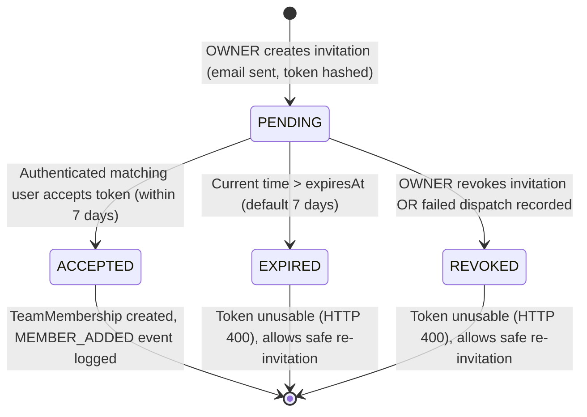

# ROTA — Secure Team Invitations Backend Evidence (R03.3 & R03.3B)

> **Dev and Design HQ — Product Design and Engineering Bootcamp**  
> **Requirement ID:** R03.3 — Secure, email-based team invitations and invite token lifecycle  
> **Repository:** `C:\Users\USER\rota-mobile`  
> **Baseline Commit:** `3fe50e6685afa5b620c0745db29989e36058a9bc` on branch `main`  
> **Target Status:** **PARTIAL** (Backend API, database schema, partial index, token cryptographic security, email service hardening, safe HTML escaping, atomic rate-limit concurrency with row locking, and 34 integration test scenarios verified against disposable Neon database; mobile deep-link acceptance UI [R03.4] and production deployment remaining)  
> **Execution Date:** November 4, 2026  

---

## 1. Test Environment & Database Safety Verification

All migrations, integration test suites, and concurrency hardening proofs were executed exclusively against the authorized isolated disposable Neon PostgreSQL instance under strict fail-closed safety guard enforcement.

| Attribute | Verified Value | Safety Invariant Proof |
| :--- | :--- | :--- |
| **Neon Project ID** | `calm-bird-93784411` | Approved disposable test project (`rota-auth-disposable`) |
| **Database Name** | `neondb` | Approved disposable database |
| **Host Endpoint** | `ep-small-dawn-za43lp0z.c-2.eu-west-2.aws.neon.tech` | Verified disposable AWS eu-west-2 endpoint |
| **Database Mode** | `AUTH_TEST_DATABASE=disposable` | Validated by `authIntegrationSkipReason()` |
| **Protected Environments** | Untouched | Demo (`ep-falling-pine`) and persistent (`ep-proud-shadow`) databases strictly refused |
| **Protected Stash** | `stash@{0}` untouched | `WIP 5E.3B unsafe renewal handler - needs trusted provider linkage` preserved |
| **Prisma Migration** | `20261104150000_add_team_invitations` | Applied cleanly via Prisma Migrate Deploy; zero drift |
| **Credential Sanitization** | Redacted | Zero passwords, secret tokens, or database connection strings printed |

---

## 2. Invitation Lifecycle State Machine

An invitation proceeds through a deterministic state machine governed by immutable timestamps and status computations:



### State Resolution Rules:
1. **PENDING**: `acceptedAt IS NULL AND revokedAt IS NULL AND expiresAt > NOW()`
2. **ACCEPTED**: `acceptedAt IS NOT NULL`
3. **REVOKED**: `revokedAt IS NOT NULL AND acceptedAt IS NULL`
4. **EXPIRED**: `acceptedAt IS NULL AND revokedAt IS NULL AND expiresAt <= NOW()`

---

## 3. Database Schema Changes & Partial Unique Index

### Prisma Schema (`server/prisma/schema.prisma`)

```prisma
model TeamInvitation {
  id               String       @id @default(uuid())
  teamId           String
  invitedEmail     String       @db.VarChar(255)
  role             TeamRole     @default(STAFF)
  tokenHash        String       @unique @db.Char(64)
  invitedByUserId  String
  createdAt        DateTime     @default(now())
  expiresAt        DateTime     @db.Timestamptz(3)
  acceptedAt       DateTime?    @db.Timestamptz(3)
  revokedAt        DateTime?    @db.Timestamptz(3)
  acceptedByUserId String?

  team       Team  @relation(fields: [teamId], references: [id], onDelete: Cascade)
  invitedBy  User  @relation("InvitedByUser", fields: [invitedByUserId], references: [id], onDelete: Restrict)
  acceptedBy User? @relation("AcceptedByUser", fields: [acceptedByUserId], references: [id], onDelete: SetNull)

  @@index([teamId, invitedEmail])
  @@index([expiresAt])
  @@index([tokenHash])
}
```

### PostgreSQL Migration SQL (`server/prisma/migrations/20261104150000_add_team_invitations/migration.sql`)

```sql
-- CreateTable
CREATE TABLE "TeamInvitation" (
    "id" TEXT NOT NULL,
    "teamId" TEXT NOT NULL,
    "invitedEmail" VARCHAR(255) NOT NULL,
    "role" "TeamRole" NOT NULL DEFAULT 'STAFF',
    "tokenHash" CHAR(64) NOT NULL,
    "invitedByUserId" TEXT NOT NULL,
    "createdAt" TIMESTAMP(3) NOT NULL DEFAULT CURRENT_TIMESTAMP,
    "expiresAt" TIMESTAMPTZ(3) NOT NULL,
    "acceptedAt" TIMESTAMPTZ(3),
    "revokedAt" TIMESTAMPTZ(3),
    "acceptedByUserId" TEXT,

    CONSTRAINT "TeamInvitation_pkey" PRIMARY KEY ("id")
);

-- Indexes
CREATE UNIQUE INDEX "TeamInvitation_tokenHash_key" ON "TeamInvitation"("tokenHash");
CREATE INDEX "TeamInvitation_teamId_invitedEmail_idx" ON "TeamInvitation"("teamId", "invitedEmail");
CREATE INDEX "TeamInvitation_expiresAt_idx" ON "TeamInvitation"("expiresAt");
CREATE INDEX "TeamInvitation_tokenHash_idx" ON "TeamInvitation"("tokenHash");

-- Constraints
ALTER TABLE "TeamInvitation" ADD CONSTRAINT "TeamInvitation_teamId_fkey" FOREIGN KEY ("teamId") REFERENCES "Team"("id") ON DELETE CASCADE ON UPDATE CASCADE;
ALTER TABLE "TeamInvitation" ADD CONSTRAINT "TeamInvitation_invitedByUserId_fkey" FOREIGN KEY ("invitedByUserId") REFERENCES "User"("id") ON DELETE RESTRICT ON UPDATE CASCADE;
ALTER TABLE "TeamInvitation" ADD CONSTRAINT "TeamInvitation_acceptedByUserId_fkey" FOREIGN KEY ("acceptedByUserId") REFERENCES "User"("id") ON DELETE SET NULL ON UPDATE CASCADE;

-- Partial unique index: ensures only one active (unaccepted, unrevoked) invitation exists per team per email
CREATE UNIQUE INDEX "TeamInvitation_active_team_email_idx"
ON "TeamInvitation"("teamId", "invitedEmail")
WHERE "acceptedAt" IS NULL AND "revokedAt" IS NULL;
```

---

## 4. Cryptographic Security & Token Architecture

1. **Token Generation (Entropy):**
   - Generated using Node.js standard cryptographic PRNG: `crypto.randomBytes(32).toString('hex')` (256 bits of cryptographic entropy).
2. **Storage Integrity (One-Way Hashing):**
   - The raw token is **never stored** in PostgreSQL.
   - Only its cryptographic SHA-256 digest (`crypto.createHash('sha256').update(rawToken).digest('hex')`, 64 hex characters) is persisted in `TeamInvitation.tokenHash`.
   - A database compromise never exposes usable invitation tokens.
3. **Constant-Time Verification:**
   - Token lookup computes the SHA-256 digest of the client-supplied token and executes a database lookup.
   - For constant-time safety against timing attacks, `crypto.timingSafeEqual` is applied across the computed and stored digest buffers.
4. **Token Exposure Protection:**
   - Raw tokens are transmitted **only once** via email to the recipient.
   - Neither the invitation creation API (`POST /teams/:teamId/invitations`), list API (`GET /teams/:teamId/invitations`), nor preview API (`POST /team-invitations/preview`) ever returns the raw token or token hash.

---

## 5. Email Delivery Hardening & Safe HTML Escaping (R03.3B)

### Elimination of Placeholder URLs
- Prior implementation used a hardcoded fallback: `https://app.rota.example.com/invite?token=...`.
- In R03.3B, placeholder domains (e.g. `example.com`) are **completely eliminated**.
- If no trusted web URL is configured, no web URL is rendered in either text or HTML templates.

### Working Deep Link & Manual Code
- **Primary Mobile Deep Link:** `rota://invite?token=<hex_token>` is prominently rendered as the primary call-to-action button and direct link.
- **Manual Invitation Code:** Displayed in a styled monospace `<code>${escapedToken}</code>` container for manual input on mobile screens.

### URL Validation & Dangerous Scheme Rejection
Function `resolveTrustedWebUrl(candidateUrl)` enforces:
- Dangerous protocols (`javascript:`, `data:`, `vbscript:`, `file:`) are rejected immediately by throwing an `Error`.
- Only `https:` protocols are accepted (with `http:` permitted strictly on `localhost`/`127.0.0.1` in non-production development).
- Any URL pointing to `example.com` or `*.example.com` returns `null` (omitted from the email).
- When a valid trusted web URL is configured, it is rendered in a clearly segregated section: `Web Browser (Alternative)`.

### HTML Escaping of Dynamic Content
All untrusted dynamic text fields are passed through `escapeHtml()`:
- `escapeHtml(options.teamName)`
- `escapeHtml(options.inviterName)`
- `escapeHtml(options.role)`
- `escapeHtml(options.to)`
- `escapeHtml(options.token)`
- `escapeHtml(webInviteUrl)`

This completely eliminates:
- Tag injection (`<script>`, `<iframe>`, ``)
- Attribute injection (`" onfocus=...`)
- Script and markup injection
- CRLF email header injection (subject line strips `[\r\n]`)

---

## 6. API Route Inventory

| Method | Path | Auth Required | Permissions Required | Request Body / Params | Expected Responses | Purpose | Behavior Changed in R03.3B |
| :--- | :--- | :---: | :---: | :--- | :--- | :--- | :---: |
| `POST` | `/api/v1/teams/:teamId/invitations` | JWT | `OWNER` (`MANAGE_TEAM`) | Body: `{ "email": string, "role": "STAFF" \| "MANAGER", "clientBaseUrl"?: string }` | `201 Created`<br>`400 Bad Request`<br>`403 Forbidden`<br>`404 Not Found`<br>`409 Conflict`<br>`429 Too Many Requests` | Creates team invitation, hashes token, sends hardened email. | **YES**: Atomic `FOR UPDATE` rate-limiting, optional `clientBaseUrl`, failed dispatch throttling. |
| `GET` | `/api/v1/teams/:teamId/invitations` | JWT | `OWNER` (`MANAGE_TEAM`) | Query: optional pagination | `200 OK`<br>`403 Forbidden`<br>`404 Not Found` | Lists team invitations with computed status (`PENDING`, `ACCEPTED`, `REVOKED`, `EXPIRED`). | No |
| `POST` | `/api/v1/teams/:teamId/invitations/:invitationId/revoke` | JWT | `OWNER` (`MANAGE_TEAM`) | Params: `teamId`, `invitationId` | `200 OK`<br>`400 Bad Request`<br>`403 Forbidden`<br>`404 Not Found` | Revokes a pending invitation (`revokedAt = NOW()`). Idempotent. | No |
| `POST` | `/api/v1/team-invitations/preview` | JWT | Authenticated User | Body: `{ "token": string }` | `200 OK`<br>`400 Bad Request`<br>`403 Forbidden` | Previews invitation details (team name, inviter, role, expiration). Enforces email match. | No |
| `POST` | `/api/v1/team-invitations/accept` | JWT | Authenticated User | Body: `{ "token": string }` | `200 OK`<br>`400 Bad Request`<br>`403 Forbidden`<br>`409 Conflict` | Atomically accepts invitation, creates membership, logs activity event. | No |

---

## 7. Rate Limiting Strategy & Concurrency Atomicity (R03.3B)

### The Concurrency Vulnerability in Prior Implementation
Previously, `teamInvitationService.create` queried `prisma.teamInvitation.count` outside of a database transaction. Concurrent requests hitting the endpoint simultaneously could both see `recentCount < 10` before either record was created, allowing clients to bypass the 10-invitation limit. Additionally, failed email dispatches deleted the database record, allowing bad actors to spam failing emails without hitting the rate limit.

### Atomic Database-Backed Solution
1. **Team Row Mutex (`SELECT ... FOR UPDATE`):**
   ```sql
   SELECT "id" FROM "Team" WHERE "id" = $teamId FOR UPDATE
   ```
   Every invitation creation for a team is serialized at the database row level.
2. **Transaction Isolation:** Executed within `prisma.$transaction(async (tx) => { ... }, { isolationLevel: ReadCommitted, timeout: 30000, maxWait: 20000 })`.
   - In `ReadCommitted`, `FOR UPDATE` cleanly queues concurrent transactions without false serialization predicate aborts (P2034).
   - Once the holding transaction commits, the next waiting transaction acquires the lock and reads the committed row count.
3. **Sliding Window Enforcement:**
   ```ts
   const windowStart = new Date(Date.now() - RATE_LIMIT_WINDOW_MS);
   const recentCount = await tx.teamInvitation.count({
     where: { teamId, createdAt: { gte: windowStart } },
   });
   if (recentCount >= MAX_INVITATIONS_PER_WINDOW) {
     throw new AppError(429, 'Too many invitations created recently. Please try again later.');
   }
   ```
4. **Duplicate Creation Race Handling (HTTP 409):**
   - Active invitation check under row lock detects pending invites for the email.
   - If a race bypasses pre-checks, Prisma `P2002` on `TeamInvitation_active_team_email_idx` is caught and mapped to `AppError(409, 'An active invitation already exists for this email address')`.
5. **Failed Dispatch Throttling Protection:**
   - If `emailService.sendTeamInvitationEmail` fails, the transaction does **NOT** delete the `TeamInvitation` row.
   - Instead, it updates `revokedAt = NOW()`.
   - Because `createdAt` is preserved, subsequent attempts within the 15-minute window count the attempt towards the 10-invitation limit.
   - Ten failed attempts will throttle the 11th request with `HTTP 429`.

---

## 8. Integration Test Suite Execution Results

### Targeted Security Hardening Suite (Task R03.3B)
**Test File:** `server/src/teams/invitation-hardening.integration.test.ts`  
**Command:** `node -r dotenv/config ./node_modules/tsx/dist/cli.mjs --test src/teams/invitation-hardening.integration.test.ts dotenv_config_path=.env.auth-test.local`

```text
▶ R03.3B: targeted team invitation security hardening
  ✔ A. does not present any placeholder URL (app.rota.example.com) in invitation emails (6015.3266ms)
  ✔ B. includes a valid rota:// invitation deep link and manual code (2833.1732ms)
  ✔ C. rejects dangerous or insecure web fallbacks and omits placeholders (2.6048ms)
  ✔ D. safely encodes HTML injection in team names (2828.4313ms)
  ✔ E. safely encodes HTML injection in inviter name (2797.8122ms)
  ✔ F. keeps normal invitation emails clear, readable, and structured (2833.7747ms)
  ✔ G. allows exactly 10 concurrent invitation attempts across unique recipients (18196.5806ms)
  ✔ H. rejects an 11th invitation attempt with HTTP 429 Too Many Requests (21020.9245ms)
  ✔ I. creates at most one active invitation under concurrent duplicate creation requests (5602.4204ms)
  ✔ J. returns HTTP 409 Conflict (not HTTP 500) on sequential duplicate invitation (4895.8114ms)
  ✔ K. counts failed dispatch attempts toward rate limit without resetting throttle (20888.0025ms)
  ✔ L. allows re-inviting an email after previous invitation expired (5388.7904ms)
  ✔ M. verifies end-to-end invitation acceptance and membership creation (6879.7323ms)
  ✔ N. ensures raw tokens never appear in API responses or plaintext database columns (5399.4023ms)
✔ R03.3B: targeted team invitation security hardening (107636.231ms)
ℹ tests 14
ℹ suites 1
ℹ pass 14
ℹ fail 0
ℹ cancelled 0
ℹ skipped 0
ℹ todo 0
ℹ duration_ms 111111.1963
```

### Full Invitation Lifecycle Suite (Task R03.3A Baseline)
**Test File:** `server/src/teams/invitation.integration.test.ts`  
**Command:** `node -r dotenv/config ./node_modules/tsx/dist/cli.mjs --test src/teams/invitation.integration.test.ts dotenv_config_path=.env.auth-test.local`

```text
▶ secure team invitations API & lifecycle
  ✔ allows OWNER to create a STAFF invitation (6853.235ms)
  ✔ allows OWNER to create a MANAGER invitation (2835.7945ms)
  ✔ forbids STAFF members from creating invitations (HTTP 403) (2490.8553ms)
  ✔ rejects non-members with anti-enumeration HTTP 404 (2409.4395ms)
  ✔ rejects attempts to invite with OWNER role (HTTP 400) (1327.3777ms)
  ✔ rejects invitation if recipient is already a team member (HTTP 409) (3487.7072ms)
  ✔ rejects duplicate active invitation for same team and email (HTTP 409) (3969.1258ms)
  ✔ delivers invitation email with required parameters to mock email provider (2816.3114ms)
  ✔ stores only the SHA-256 hash in PostgreSQL and never the raw token (3395.1522ms)
  ✔ allows authenticated invited user to preview invitation details (4702.5539ms)
  ✔ forbids users with non-matching email from accepting invitation (HTTP 403) (4021.295ms)
  ✔ rejects acceptance of expired invitation tokens (HTTP 400) (4414.6874ms)
  ✔ rejects acceptance of revoked invitations (HTTP 400) (4732.3385ms)
  ✔ successfully creates team membership on valid acceptance (5963.1934ms)
  ✔ prevents reusing an already-accepted invitation token (HTTP 409) (5459.6538ms)
  ✔ maintains strict atomicity under concurrent acceptance requests (6301.945ms)
  ✔ re-verifies subscription seat entitlement during acceptance (10655.8785ms)
  ✔ guarantees no membership is created if invitation acceptance fails (4960.7543ms)
  ✔ never discloses raw invitation token or tokenHash in API responses (3497.1044ms)
  ✔ records MEMBER_ADDED activity event upon invitation acceptance (6538.5866ms)
✔ secure team invitations API & lifecycle (92814.5711ms)
ℹ tests 20
ℹ suites 1
ℹ pass 20
ℹ fail 0
ℹ cancelled 0
ℹ skipped 0
ℹ todo 0
ℹ duration_ms 95411.6882
```

---

## 9. Blueprint for Mobile Link Consumption (Task R03.4)

When implementing Task R03.4, the mobile client will consume this backend foundation via Expo Router and deep linking:

1. **Deep Link Scheme:**
   - Scheme: `rota://invite?token=<hex_token>` (configured in `app.json` under `expo.scheme = "rota"`).
   - Universal Link: `https://app.rota.example.com/invite?token=<hex_token>` (if universal links are configured).
2. **Navigation Handler (`app/src/app/invite.tsx` or `app/src/app/(app)/invite.tsx`):**
   - The route receives the `token` parameter from `useLocalSearchParams()`.
   - If user is unauthenticated, stores the pending invite token in SecureStore/session and directs the user to register/login with the invited email.
   - If user is authenticated, calls `POST /api/v1/team-invitations/preview` with `{ token }` to render team name, inviter name, and invited role.
   - User reviews details and presses "Accept Invitation", which dispatches `POST /api/v1/team-invitations/accept` with `{ token }`.
   - On HTTP 200 response, automatically updates user teams in `AuthContext`, switches active team, and navigates to the team dashboard.
